<div align="center">

<picture>
  <source media="(prefers-color-scheme: dark)" srcset="docs/brand/logo-dark.png">
  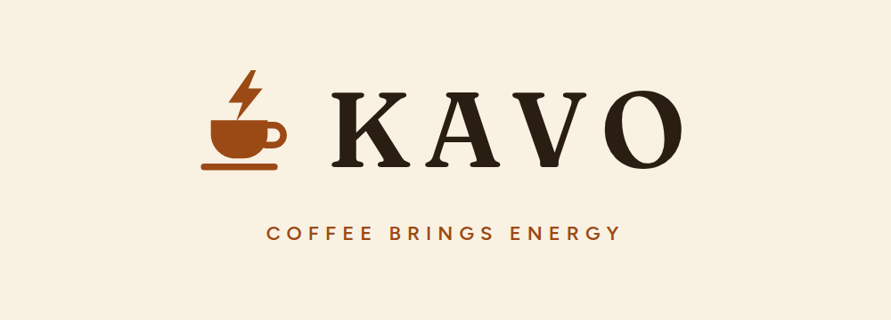
</picture>

# KAVO: Website & Admin Panel

A full-stack platform for **KAVO**, a coffee and food cafe in Faisalabad. It includes a public website with online ordering and table reservations, an admin panel that controls everything the site shows, and a REST API used by the [KAVO mobile app](https://github.com/sytal/kavo-app).

**🌐 Website:** [kavo.sytal.io](https://kavo.sytal.io) · **🛠 Admin:** [kavo-admin.sytal.io](https://kavo-admin.sytal.io) · **📱 App:** [kavo-app](https://github.com/sytal/kavo-app)


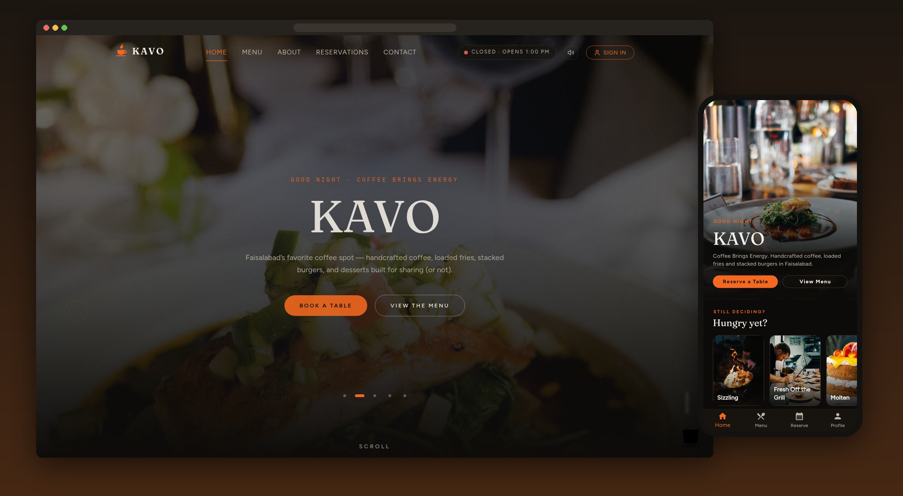

</div>

## Try the demo

| Role | Email | Password | What you can do |
|---|---|---|---|
| **Admin** (read-only) | `demo.admin@kavo.sytal.io` | `DemoAdmin#2026` | Open every admin screen. Saving is disabled so the demo stays clean. |
| **Customer** | `demo.customer@kavo.sytal.io` | `DemoCustomer#2026` | Place orders, view order history, book a table. Works on the website and the app. |

Customers sign in on [kavo.sytal.io](https://kavo.sytal.io/login). The admin panel lives at [kavo-admin.sytal.io](https://kavo-admin.sytal.io).

## Features

### Public website
- **Hero slider and live status.** An animated hero with the *Coffee Brings Energy* tagline shows an "Open now / Opens at 1:00 PM" badge calculated from the cafe's business hours.
- **Interactive menu.** Category tabs, live search, dish tags and a full-screen dish view.
- **Online ordering.** Customers add dishes to a tray, check out with cash on delivery and track orders on the *My Orders* page.
- **Table reservations.** Bookings use time slots generated from opening hours, with validation for party size and date.
- **Contact form and newsletter.** Messages land in the admin inbox with a live notification.
- **Light, dark and auto themes.** Three colour themes that admins switch without a deploy. Auto follows the visitor's device.
- **Responsive and smooth.** Inertia SPA navigation (no full page reloads), Framer Motion animations and Lenis smooth scrolling.

### Admin panel
- **Dashboard.** Today's orders, bookings and unread messages, plus the latest activity.
- **Real-time notifications.** New orders, bookings and messages raise a toast with a chime and a tab badge. Desktop notifications fire while the tab is in the background.
- **Orders.** One-click status flow: Pending → Preparing → Out for Delivery → Completed. Includes filters, search and an order detail view.
- **Menu management.** Add, edit, delete, reorder and mark items sold out. Categories, tags and image upload with a drag-and-drop zone.
- **Reservations and messages.** Confirm or cancel bookings. Read and clear messages.
- **Website content editor.** Edit headings, text and images of every homepage section, and reorder sections.
- **Gallery, appearance and business info.** Manage images, the colour theme, phone, address, opening hours, socials and delivery fee. Both the website and the app pick up these changes.
- **Role-based access.** `admin` and `manager` roles, an optional separate admin subdomain, and a read-only demo admin mode for public showcases.

### REST API (`/api/v1`)
Powers the mobile app. Public endpoints cover the menu, categories, gallery, content, theme and business info. Login, register, profile and orders use **Laravel Sanctum** tokens. Write endpoints are throttled.

## Screenshots

<table>
  <tr>
    <td>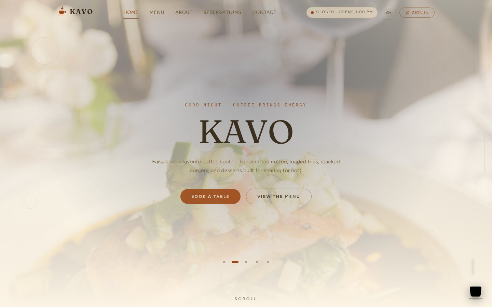</td>
    <td>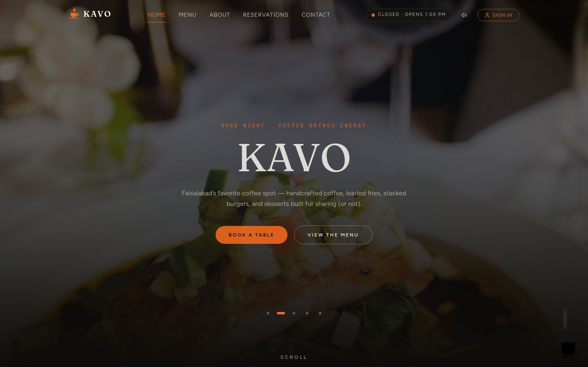</td>
  </tr>
  <tr>
    <td align="center"><sub>Home: light theme</sub></td>
    <td align="center"><sub>Home: dark theme</sub></td>
  </tr>
  <tr>
    <td>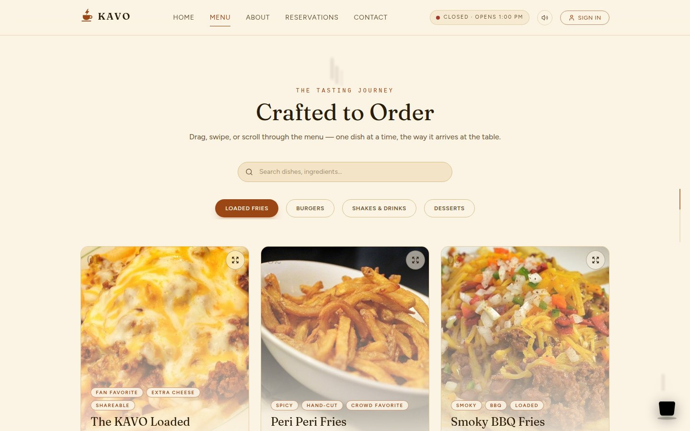</td>
    <td>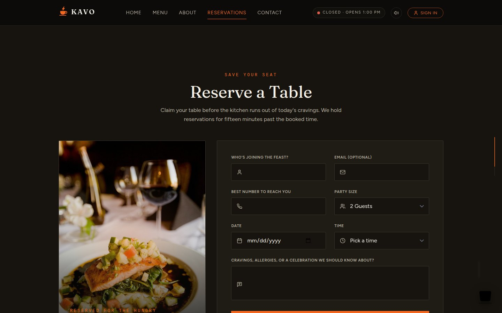</td>
  </tr>
  <tr>
    <td align="center"><sub>Menu with categories, search and tags</sub></td>
    <td align="center"><sub>Table reservations</sub></td>
  </tr>
  <tr>
    <td>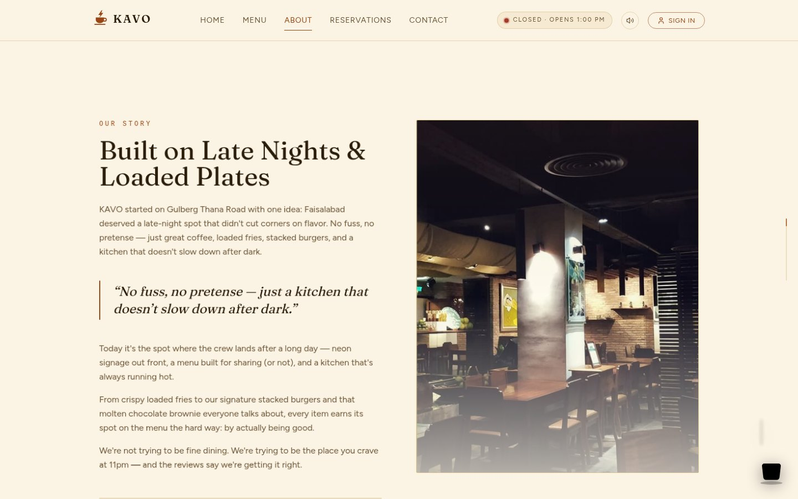</td>
    <td>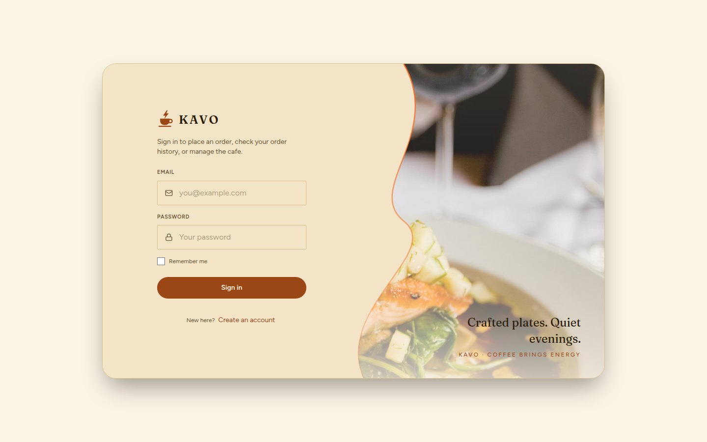</td>
  </tr>
  <tr>
    <td align="center"><sub>Our story</sub></td>
    <td align="center"><sub>Sign in / register</sub></td>
  </tr>
</table>

<p align="center">
  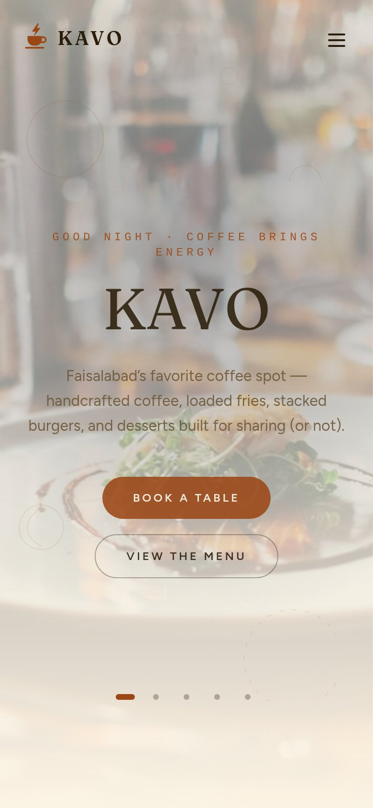
  &nbsp;&nbsp;
  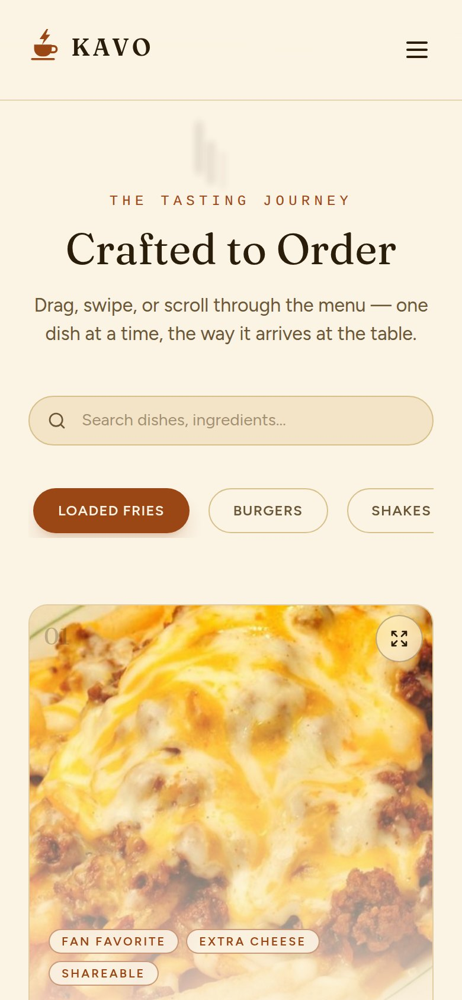
  <br><sub>Fully responsive on phones</sub>
</p>

### Admin panel

<table>
  <tr>
    <td>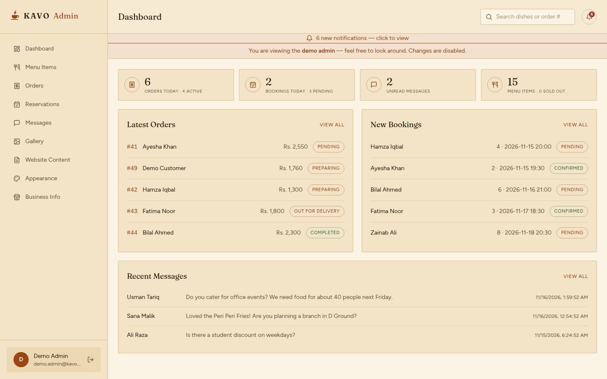</td>
    <td>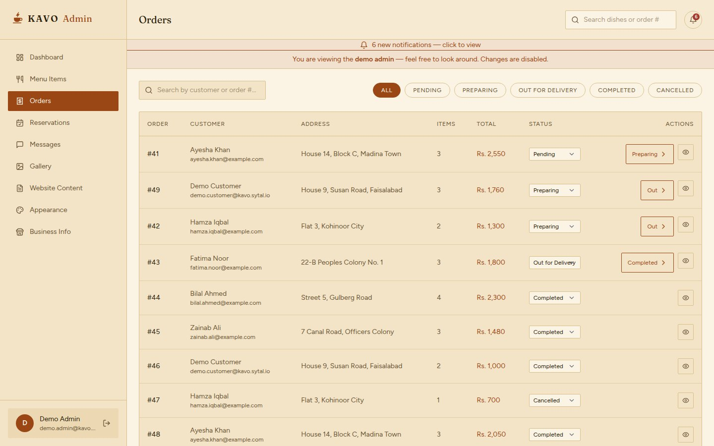</td>
  </tr>
  <tr>
    <td align="center"><sub>Dashboard</sub></td>
    <td align="center"><sub>Orders and status flow</sub></td>
  </tr>
  <tr>
    <td>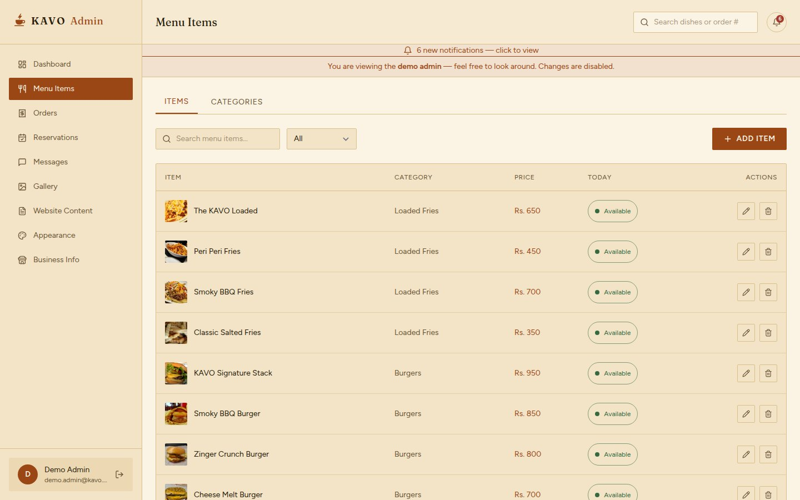</td>
    <td>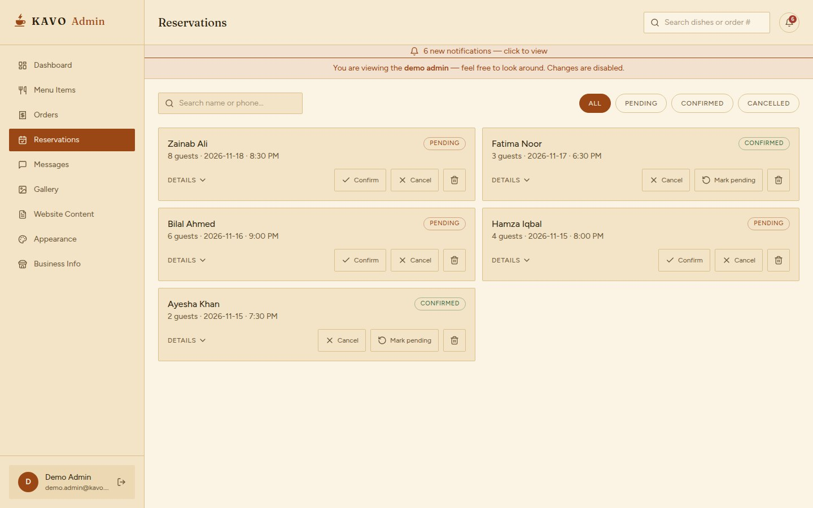</td>
  </tr>
  <tr>
    <td align="center"><sub>Menu management</sub></td>
    <td align="center"><sub>Reservations</sub></td>
  </tr>
  <tr>
    <td>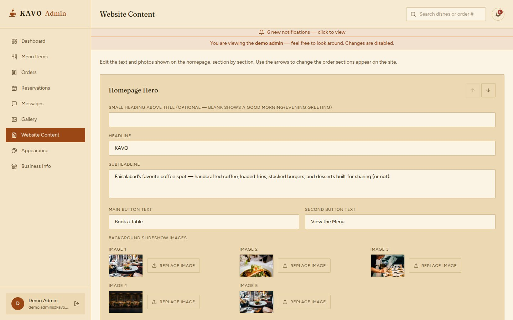</td>
    <td>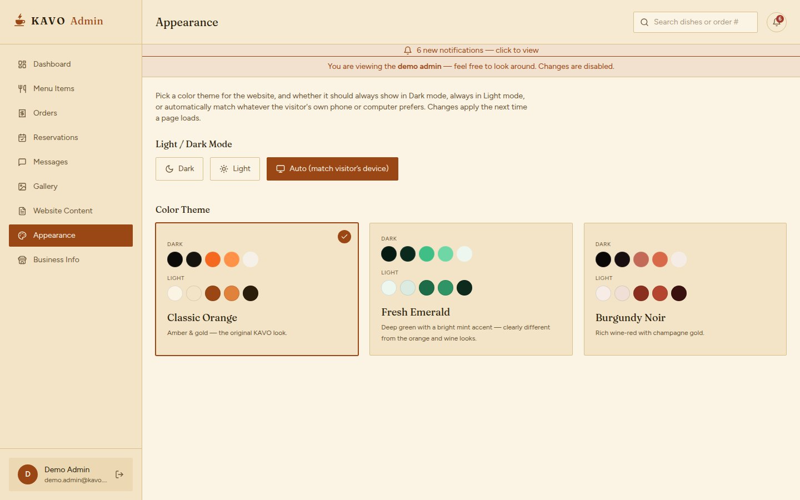</td>
  </tr>
  <tr>
    <td align="center"><sub>Website content editor</sub></td>
    <td align="center"><sub>Themes: light, dark and auto</sub></td>
  </tr>
</table>

### One backend, two front ends

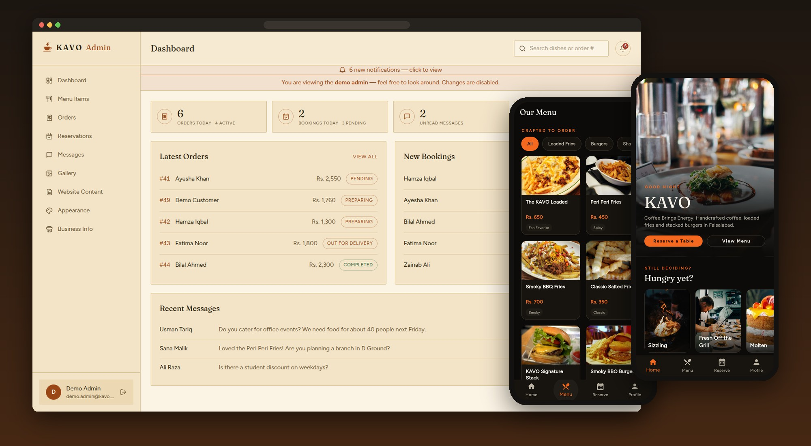

## Tech stack

| Layer | Tools |
|---|---|
| Backend | Laravel 13 (PHP 8.3+), Eloquent, form requests, a service layer and role middleware |
| Frontend | React 18 with Inertia.js 2, Tailwind CSS, Framer Motion, Lenis and React Icons, built with Vite |
| Database | MySQL (InnoDB) |
| API and auth | Laravel Sanctum tokens for the app, session auth for the web |
| Testing | PHPUnit feature tests (60 tests) on an in-memory SQLite database |

## Project structure

```
app/
  Http/Controllers/     Web and API v1 controllers
  Http/Middleware/      Role gate, admin subdomain, demo read-only guard, Inertia shared props
  Http/Requests/        Validation for orders, reservations and contact
  Models/               MenuItem, Order, Reservation, ContentBlock, ThemeSetting, ...
  Services/             Business logic (orders, menu, content, theme, business info)
database/seeders/       Menu, content, gallery, admin and demo data
resources/js/
  Pages/                Home, Auth, Orders and Admin/* (Inertia pages)
  Components/           Website sections and admin UI components
  config/colors.js      Single source of truth for colours
routes/web.php          Website and admin routes
routes/api.php          REST API for the mobile app
```

## Getting started

**Requirements:** PHP 8.3+, Composer, Node 20+ and MySQL.

```bash
git clone https://github.com/sytal/sytal-coffee.git
cd sytal-coffee

composer install
npm install

cp .env.example .env
php artisan key:generate
# Set DB_DATABASE, DB_USERNAME, DB_PASSWORD, ADMIN_EMAIL and ADMIN_PASSWORD in .env

php artisan migrate --seed
npm run build            # or `npm run dev` while developing
php artisan serve
```

Admin image uploads go straight to `public/uploads/`, so no `storage:link` is needed. The `php/uploads.ini` file raises PHP's upload limit for local development. Start the server with `PHP_INI_SCAN_DIR=":$PWD/php" php artisan serve` to load it.

### Deploying (website + admin subdomain)

Point both domains at the same Laravel `public/` folder and set:

```env
APP_URL=https://kavo.sytal.io
ADMIN_URL=https://kavo-admin.sytal.io
```

With `ADMIN_URL` set, opening the admin host goes straight to the admin sign-in, and any `/admin` link on the public site moves to the admin host. Leave it empty locally and everything runs on one host.

### Demo mode

To host a public demo, set this in `.env`:

```env
DEMO_MODE=true
```

Then seed the demo accounts and sample data:

```bash
php artisan db:seed --class=DemoUserSeeder
php artisan db:seed --class=DemoDataSeeder   # sample orders, bookings and messages around today's date
```

`DemoDataSeeder` replaces only its own records, so it is safe to run on a daily schedule to keep the demo fresh. With demo mode on, the demo admin can browse everything but any change returns *"Demo account is read-only"*.

## Running tests

```bash
php artisan test
```

## Related

- **Mobile app:** [sytal/kavo-app](https://github.com/sytal/kavo-app). A Flutter app for Android and the web that uses this API.
